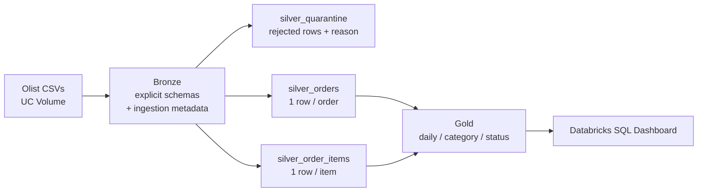
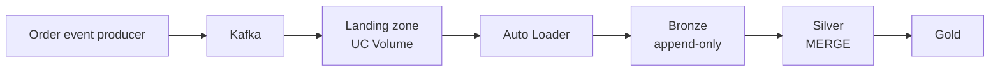
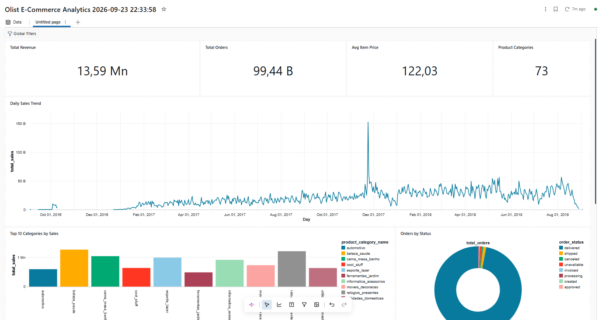

# Databricks E-Commerce Data Platform

An end-to-end data engineering project on Databricks: the Olist Brazilian
E-Commerce dataset flows through a Bronze → Silver → Gold lakehouse built on
Unity Catalog and Delta Lake, ending in a Databricks SQL dashboard.

The project is built like a production codebase: transformation logic is a
tested Python package, notebooks are thin entry points, the pipeline is deployed
as code with Databricks Asset Bundles, CI runs on every pull request, and design
decisions are recorded as ADRs.

## Architecture



All tables are Unity Catalog managed Delta tables in `workspace.olist`, named
`<layer>_<entity>`. The job `olist_medallion` runs the three layers in order on
serverless compute.

| Layer | Tables | What happens |
|---|---|---|
| Bronze | `bronze_orders`, `bronze_customers`, `bronze_products`, `bronze_order_items`, `bronze_payments`, `bronze_category_translation` | CSV read with an explicit schema; unparseable values kept in `_rescued_data`; `_ingested_at` and `_source_file` added |
| Silver | `silver_orders`, `silver_order_items`, `silver_quarantine` | Quality rules, deduplication, joins, payments aggregated per order, English category names |
| Gold | `gold_daily_sales`, `gold_category_sales`, `gold_order_status` | Business metrics for the dashboard |

### Target streaming architecture (Phase 2)



## Design decisions

Each decision with business or architectural impact is recorded in
[`docs/decisions/`](docs/decisions):

| ADR | Decision |
|---|---|
| [0001](docs/decisions/0001-medallion-on-unity-catalog.md) | UC managed tables for every layer; Silver split by grain; `MERGE` only in Silver |
| [0002](docs/decisions/0002-silver-data-quality-rules.md) | Rows breaking quality rules go to a quarantine table with the reason, not silently dropped |
| [0003](docs/decisions/0003-revenue-definition.md) | Revenue = `sum(price)` excluding `canceled` and `unavailable` orders; freight reported separately |

Incidents are documented as blameless postmortems in
[`docs/incidents/`](docs/incidents). Example:
[Bronze MERGE pollution](docs/incidents/2026-10-11-bronze-merge-pollution.md).

## Analytics dashboard



Dashboard datasets query the Gold tables, for example:

```sql
-- KPI tiles
SELECT sum(total_revenue)            AS total_revenue,
       sum(total_orders)             AS total_orders,
       sum(total_revenue) / sum(items_sold) AS average_item_price
FROM workspace.olist.gold_daily_sales;

-- Top 10 categories
SELECT product_category, total_revenue
FROM workspace.olist.gold_category_sales
ORDER BY total_revenue DESC
LIMIT 10;
```

## Project structure

```text
databricks-ecommerce-data-platform/
├── databricks.yml               # Asset Bundle: olist_medallion job
├── pyproject.toml               # package, dev dependencies, ruff, pytest
├── src/olist_platform/
│   ├── config.py                # catalog, schema, Volume path, table names
│   ├── schemas.py               # explicit Bronze schemas
│   ├── bronze.py                # CSV -> Bronze
│   ├── silver.py                # quality rules + grain-specific Silver tables
│   └── gold.py                  # business metrics
├── notebooks/                   # thin Databricks entry points (source format)
│   ├── 02_bronze_ingestion.py
│   ├── 03_silver_transformation.py
│   └── 04_gold_analytics.py
├── tests/                       # PySpark unit tests (local SparkSession)
├── docs/
│   ├── decisions/               # ADRs
│   ├── incidents/               # postmortems
│   └── dashboard.png
└── .github/workflows/ci.yml     # lint + tests on every PR
```

## Getting started

### Local development

Requires Python 3.10+ and Java 17+.

```bash
python -m venv .venv
.venv/bin/pip install -e ".[dev]"   # Windows: .venv\Scripts\pip
ruff check . && ruff format --check .
pytest
```

> On Windows, keep the virtual environment on a path without non-ASCII
> characters; Spark's launcher cannot handle them in its classpath.

### Deploy and run on Databricks

1. Upload the Olist CSVs (including `product_category_name_translation.csv`) to
   the Volume `/Volumes/workspace/default/olist_data/`.
2. Install the [Databricks CLI](https://docs.databricks.com/dev-tools/cli/) and
   sign in: `databricks auth login --host <workspace-url>`.
3. Deploy and run:

```bash
databricks bundle validate
databricks bundle deploy
databricks bundle run olist_medallion
```

## Technology stack

Python · PySpark · Databricks (Free Edition, serverless) · Delta Lake · Unity
Catalog · Databricks Asset Bundles · Databricks SQL · pytest · ruff · GitHub
Actions · *planned:* Apache Kafka, Auto Loader, Structured Streaming

## Status

### Phase 1: Foundation
- [x] Bronze on UC managed tables with explicit schemas and ingestion metadata
- [x] Silver split by grain, with a quarantine table for rejected rows
- [x] Gold metrics with an explicit revenue definition
- [x] Python package with unit tests; notebooks as thin entry points
- [x] CI: lint and tests on every pull request
- [x] Pipeline defined as a job via Databricks Asset Bundles
- [ ] End-to-end run verified on Databricks
- [ ] Dashboard re-pointed to the new Gold tables

### Phase 2: Streaming and incremental processing
- [ ] Order event producer and Kafka (Docker)
- [ ] Landing zone + Auto Loader into append-only Bronze
- [ ] Incremental `MERGE` into Silver
- [ ] Event-time windows and watermarking in Gold

### Phase 3: Data quality and observability
- [ ] Quality metrics and alerts on `silver_quarantine`
- [ ] Pipeline run metrics

### Phase 4: Performance
- [ ] Liquid clustering and `OPTIMIZE`
- [ ] Query plan analysis
